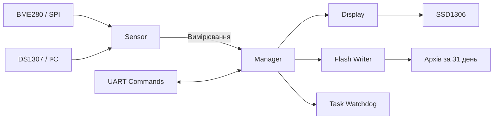

# Environmental Data Logger

Автономний реєстратор мікроклімату на ESP32-S3: вимірювання температури, вологості й тиску, локальний архів за 31 календарний день та відновлення роботи після програмних зависань.

**C · ESP-IDF 6.1 · FreeRTOS · SPI · I²C · UART · Light Sleep**

## Можливості

- Вимірювання BME280 та оновлення OLED щосекунди.
- Архівування кожні 30 секунд: поточний день UTC і 30 попередніх, до 89 280 вимірювань за 31 повну добу.
- Циклічна ротація за днями без ручного очищення після заповнення.
- CRC32 записів і заголовків, відновлення індексу після перезапуску.
- Годинник DS1307 із резервним живленням; зберігання UTC та відображення місцевого часу.
- Керування через UART: стан пристрою, читання архіву, налаштування часу й режиму запису.
- Task Watchdog із panic та перезавантаженням; незалежний контроль робочих задач.
- Light Sleep між вимірюваннями з пробудженням за таймером або через UART.

## Архітектура

| Модуль | Призначення |
| --- | --- |
| `main/sensor` | Вимірювання BME280, читання та встановлення RTC |
| `main/display` | Формування кадру OLED |
| `main/storage` | Добовий кільцевий архів, CRC, збереження та відновлення |
| `main/uart` | Розбір команд та обмін через UART0 |
| `main/manager` | Розклад, стани, маршрутизація повідомлень і сон |
| `main/watchdog` | Перевірка строків виконання операцій та керування TWDT |
| `main/time` | UTC, часовий пояс і часова позначка збірки |

Задачі обмінюються значеннями через черги FreeRTOS. Кожен драйвер має одного власника; спільну шину I²C захищено mutex. Асинхронний logger передає діагностику в системну консоль USB Serial/JTAG. Апаратні адаптери надає бібліотека VolkCoreEmbedded.

## Зберігання даних

Розділ `logdata` займає **1488 КіБ**: 31 слот по 48 КіБ. Слот відповідає календарному дню UTC. Під час першого вимірювання нового дня зберігається буфер попереднього дня та повторно використовується слот, що вийшов за межі вікна зберігання. Пропущені дні не заповнюються штучними даними.

Запис займає 16 байтів і містить UTC timestamp, температуру, вологість, тиск та CRC32. RAM-буфер — **1024 байти, 64 записи**. Повний буфер автоматично зберігається кожні **32 хвилини**. Команда `flush` зберігає лише накопичені записи, тому часті збереження не витрачають вільні залишки секторів. Під час зміни дня буфер також зберігається автоматично.

`read` повертає записи від старих до нових. Індекс `0` відповідає найстарішому доступному запису та змінюється після ротації. Протягом поточної доби глибина архіву становить від 30 до 31 доби. Вимкнення пристрою або недоступність датчика залишають пропуски.

| Область flash | Розмір |
| --- | ---: |
| Завантажувач і службові області | 64 КіБ |
| Застосунок | 448 КіБ |
| Добовий архів | 1488 КіБ |
| Нерозподілений резерв | 48 КіБ |

## Апаратна платформа

ESP32-S3, BME280 із чотирипровідним SPI, DS1307, SSD1306 128×64 та вбудований USB–UART міст плати. Конфігурація flash — 2 МіБ.

| Інтерфейс | GPIO |
| --- | --- |
| I²C SDA / SCL | 8 / 9 |
| SPI MOSI / MISO / SCLK / CS | 11 / 13 / 12 / 10 |
| UART0 TX / RX | 43 / 44 |

Схема підключення й вимоги до рівнів сигналів: [підключення обладнання](docs/wiring_and_uart.md).

## Збирання та запуск

1. Установити ESP-IDF 6.1 та ініціалізувати підмодулі Git: `git submodule update --init --recursive`.
2. У середовищі ESP-IDF вибрати ціль: `idf.py set-target esp32s3`.
3. Перевірити GPIO й часовий пояс у `idf.py menuconfig` → **Environmental Data Logger**.
4. Зібрати проєкт: `idf.py build`.
5. Прошити застосунок і таблицю розділів: `idf.py -p PORT flash monitor`.
6. Відкрити COM-порт вбудованого USB–UART плати (UART0): **115200, 8N1, без керування потоком**, завершення рядка LF або CRLF.
7. Установити актуальний час UTC командою `time set YYYY-MM-DDTHH:MM:SSZ` та перевірити `status`.

**Оновлення розмітки архіву:** потрібні дані слід попередньо вивантажити старою прошивкою. Розташування розділу й розмір добових слотів змінено; попередній архів, зокрема варіант v2 на 744 КіБ, несумісний із новою розміткою. Після прошивання нової таблиці розділів виконати `erase`, а потім `log on`. Очищення видаляє архів; автоматичне перетворення не передбачене.

## Команди

| Команда | Призначення |
| --- | --- |
| `status` | Стан датчиків, архіву, сну, WDT і причина перезапуску |
| `log on` / `log off` | Увімкнення / зупинення накопичення |
| `flush` | Збереження RAM-буфера |
| `read` | Останні 16 збережених записів |
| `read first count` | Читання із заданого індексу; до 256 записів |
| `time set YYYY-MM-DDTHH:MM:SSZ` | Установлення UTC у RTC |
| `erase` | Повне очищення архіву; запис залишається вимкненим |
| `help` | Довідка |

Для пробудження надіслати `UUU` і переведення рядка, дочекатися `READY`, після чого вводити команду. Через 30 секунд без вхідних даних поновлюється періодичний сон. Команди та відповіді виводяться через вбудований USB–UART (UART0). Щосекундний стан, діагностика застосунку, системні логи та panic виводяться через USB Serial/JTAG на другому, прямому USB-роз’ємі. Перед відкриттям іншого термінала закрити monitor, якщо він займає той самий COM-порт.

## Надійність та обмеження

TWDT контролює Manager із таймаутом 5 секунд. Окремі строки контролюють Sensor, Display, UART, підготовку сну та поступ виконання операцій Flash. Помилка пристрою з отриманою відповіддю не вважається зависанням. [Принцип роботи WDT і сценарії перевірки](docs/watchdog.md).

CRC виявляє пошкоджені записи; зайняті байти перерваного запису повторно не програмуються. Ротація звільняє старий день повністю. Втрата живлення під час ротації може видалити цей день до збереження першого запису нового дня. Незбережений RAM-буфер втрачається під час скидання або вимкнення живлення. Перед плановим вимкненням виконати `log off`, потім `flush`.

Переведення RTC назад за останній архівний 30-секундний інтервал зупиняє накопичення, захищаючи хронологію. Повторний запис того самого інтервалу пропускається. Після виправлення часу запис вмикається командою `log on`. Часті апаратні збої можуть вичерпати резерв пошкоджених записів усередині дня. Проєкт не використовує файлову систему й не підтримує шифрування розділу архіву.

## Документація

- [Технічна специфікація](docs/technical_specification.md)
- [Формат архіву та відновлення](docs/storage.md)
- [Підключення й UART](docs/wiring_and_uart.md)
- [Watchdog](docs/watchdog.md)
- [Критерії перевірки](docs/verification.md)

## Ліцензія

Умови використання наведено у [LICENSE](LICENSE).
